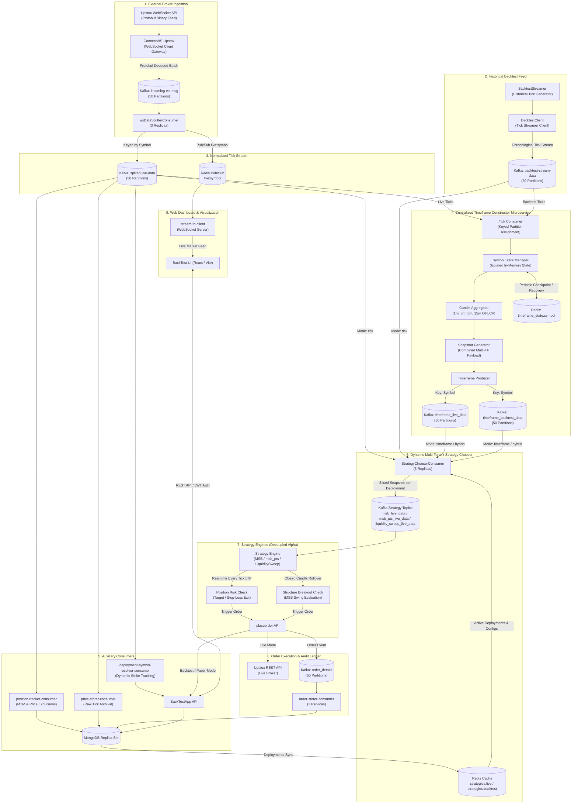
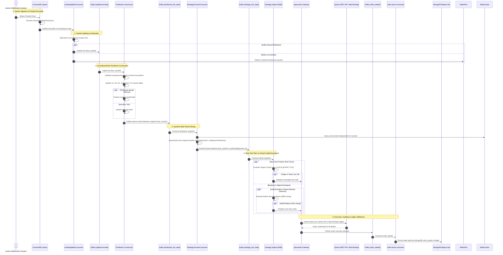

# MoneyMaker — System Architecture & Technical Specification

This document provides a comprehensive technical reference for the **MoneyMaker Algo Trading Platform**, describing its distributed microservices architecture, centralized timeframe processing framework, Kafka partition routing, multi-tenant state management, and real-time execution guarantees.

---

## 1. System Topology & Architecture Overview

MoneyMaker is an event-driven algorithmic trading and backtesting engine for high-volume Indian equity and derivative instruments (NSE/NFO).



---

## 2. End-to-End Sequence & Execution Lifecycle



---

## 3. Detailed Data Flow Architecture

### 3.1 Live Trading Pipeline
1. **Upstox WebSocket Ingestion:**
   `ConnectWS-Upstox` connects to `wss://api.upstox.com/v3/feed/market-data-feed`. Binary Protobuf messages are decoded into JSON tick arrays and published as batches to `incoming-ws-msg` (key: `uplink_ws_data`).
2. **Key-Partitioned Symbol Splitting:**
   `wsDataSplitterConsumer` consumes from `incoming-ws-msg`, unbatches items into individual symbol ticks, and publishes them to `splited-live-data` using `symbol` as the partition key. It also publishes to Redis Pub/Sub `live:<symbol>` for live chart streaming.
3. **Centralized Timeframe Aggregation:**
   `timeframe-constructor` consumes `splited-live-data`. For each symbol, it updates in-memory OHLCV states across all standard intervals (`1m`, `3m`, `5m`, `15m`). On bucket rollover, it produces `closedCandle` and resets `formingCandle`. It emits combined atomic snapshots to `timeframe_live_data` (keyed by `symbol`).
4. **Dynamic Multi-Tenant Slicing & Routing:**
   `StrategyChooserConsumer` subscribes to both `splited-live-data` and `timeframe_live_data`. When a timeframe snapshot arrives, it queries Redis for active deployments subscribed to that symbol, verifies their `data_mode` (`timeframe` or `hybrid`), strips timeframes that the deployment did not request, and dispatches the payload to the strategy topic (e.g. `msb_live_data`).
5. **Decoupled Strategy Processing:**
   Strategy engines inherit from `Strategy.js`.
   - **Continuous Risk Check:** Every tick's `ltp` immediately checks Target and Stop-Loss limits.
   - **Structural Signal Evaluation:** Structural breakout signals (e.g., MSB swing points) are evaluated **exclusively on completed `closedCandle` bars**.
6. **Execution & Settlement:**
   `placeorder` routes to Upstox API for live accounts or internal simulation for backtest/paper accounts. Successful fills are published to `order_details`, which `order-storer-consumer` records in MongoDB.

### 3.2 Chronological Backtesting Pipeline
1. **Deterministic Historical Playback:**
   `backtest-streamer` generates historical ticks chronologically and sends them to `backtest-client`.
2. **Backtest Bus:**
   `backtest-client` forwards ticks to `backtest-stream-data` partitioned by `symbol`.
3. **Centralized Backtest Aggregation:**
   `timeframe-constructor` consumes `backtest-stream-data` and aggregates candles identically to the live pipeline, publishing snapshots to `timeframe_backtest_data`.
4. **Isolated Deployment Partitioning:**
   `StrategyChooserConsumer` consumes `timeframe_backtest_data` and publishes to `${strategyName}_backtest_data` using `${symbol}:${deployment_id}` as the partition key. This prevents message interleaving across concurrent backtests on the same instrument.
5. **BacktestApp Matching Engine:**
   Simulates orders, slippage, charges, and updates backtest balances and ledger records.

---

## 4. Timeframe Constructor Microservice Internals

### 4.1 Internal Module Organization
```
kafka/services/timeframeConstructor/
├── src/
│   ├── app.js                          # Process bootstrap & Kafka lifecycle
│   ├── consumers/
│   │   └── tickConsumer.js             # Consumes splited-live-data & backtest-stream-data
│   ├── producers/
│   │   └── timeframeProducer.js        # Produces to timeframe_live_data & timeframe_backtest_data
│   ├── core/
│   │   ├── timeBoundary.js             # IST bucket calculation & interval normalization
│   │   ├── candleAggregator.js         # OHLCV calculation, session bounds, rollovers
│   │   ├── symbolStateManager.js       # In-memory Map of SymbolTimeframeState
│   │   └── snapshotGenerator.js        # Multi-timeframe atomic snapshot assembler
│   ├── storage/
│   │   └── persistenceService.js       # Redis checkpointing & crash-recovery hydration
│   └── utils/
│       ├── tickValidator.js            # Input tick validation & extraction
│       └── volumeCalculator.js         # Cumulative vs delta volume tracking
└── __tests__/                          # Native Node.js unit test suite
```

### 4.2 Time Boundary Calculation
Candles are calculated strictly from vendor exchange event timestamps (`ltpc.ltt` or `timestamp`) in the `Asia/Kolkata` timezone:
- Timeframe intervals: `1m` (60s), `3m` (180s), `5m` (300s), `15m` (900s), `30m` (1800s), `1h` (3600s), `1d` (86400s).
- Integer arithmetic: `bucketStart = Math.floor(epochMs / intervalMs) * intervalMs`.
- Market session check: 09:15 to 15:30 IST.

### 4.3 Atomic Multi-Timeframe Snapshot Schema
```json
{
  "eventId": "NIFTY-1793594160000-8472",
  "symbol": "NSE_INDEX|Nifty 50",
  "eventTimestamp": 1793594160000,
  "snapshotVersion": 1,
  "ltp": 26012.50,
  "volume": 12450,
  "timeframes": {
    "1m": {
      "timeframe": "1m",
      "startTime": 1793594100000,
      "endTime": 1793594160000,
      "formingCandle": {
        "open": 26000.00,
        "high": 26015.00,
        "low": 25998.50,
        "close": 26012.50,
        "volume": 12450,
        "isClosed": false,
        "updatedAt": 1793594160000
      },
      "closedCandle": {
        "open": 25985.00,
        "high": 26005.00,
        "low": 25980.00,
        "close": 26000.00,
        "volume": 45200,
        "isClosed": true,
        "updatedAt": 1793594100000
      }
    },
    "5m": {
      "timeframe": "5m",
      "startTime": 1793593800000,
      "endTime": 1793594100000,
      "formingCandle": {
        "open": 25950.00,
        "high": 26020.00,
        "low": 25945.00,
        "close": 26012.50,
        "volume": 182300,
        "isClosed": false,
        "updatedAt": 1793594160000
      },
      "closedCandle": null
    }
  }
}
```

---

## 5. Kafka Topics & Partitioning Map

| Topic | Partitions | Key Strategy | Retention | Role |
| :--- | :--- | :--- | :--- | :--- |
| `incoming-ws-msg` | 50 | Static / Uplink | 4 Hours | Raw batched vendor data stream from Upstox. |
| `splited-live-data` | 50 | `symbol` | 24 Hours | Normalized individual symbol ticks. |
| `backtest-stream-data` | 50 | `symbol` | 24 Hours | Historical tick stream for backtesting. |
| `timeframe_live_data` | 50 | `symbol` | 24 Hours | Centralized multi-timeframe live snapshots. |
| `timeframe_backtest_data` | 50 | `symbol` | 24 Hours | Centralized multi-timeframe backtest snapshots. |
| `msb_live_data` | 50 | `symbol` | 24 Hours | Live data routed to MSB strategy engines. |
| `msb_backtest_data` | 50 | `${symbol}:${deployment_id}` | 24 Hours | Backtest data routed to MSB strategy engines. |
| `order_details` | 50 | `order_id` / `symbol` | 7 Days | Audit trail of placed and filled orders. |

---

## 6. Multi-Tenant Deployment Model & Database Persistence

### Deployment Schema Extensions (`BackTest/BackTestApp/src/models/deployment.js`)
- `timeframes: [String]` — Declared timeframe requirements (e.g., `["1m", "5m"]`). Defaults to `["1m"]`.
- `data_mode: String` — `"tick"`, `"timeframe"`, or `"hybrid"`. Defaults to `"timeframe"`.

### Redis Cache Keys
- `strategies:live:<symbol>` — JSON array of active live deployments.
- `strategies:backtest:<symbol>` — JSON array of active backtest deployments.
- `timeframe_state:<symbol>` — Periodic checkpoint of symbol candle state.
- `live:<symbol>` — Real-time tick Pub/Sub channel for frontend charts.
