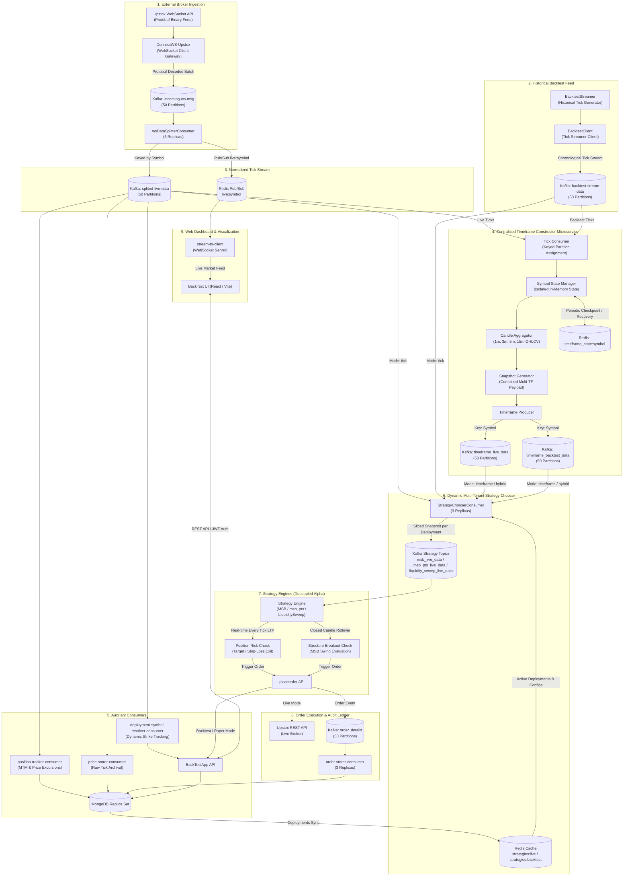
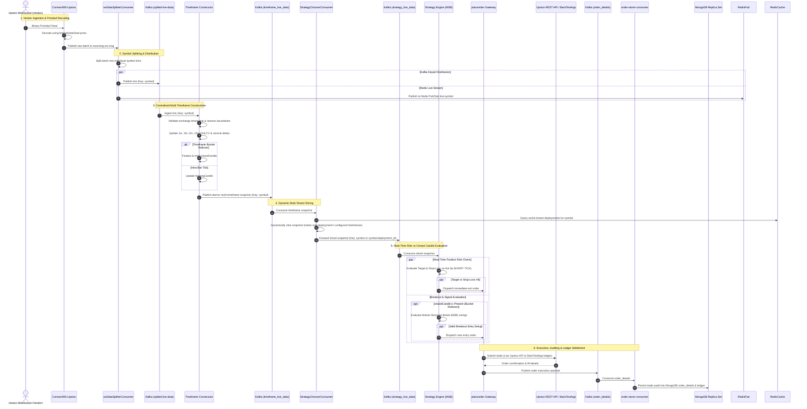

# MoneyMaker — Algorithmic Trading & Backtesting Platform

[](https://github.com/prabuselvamnatarajan/moneymaker_aws/actions/workflows/deploy.yml)
[](https://nodejs.org/)
[](https://kafka.apache.org/)
[](https://redis.io/)
[](https://www.mongodb.com/)
[](https://k3s.io/)

MoneyMaker is an enterprise-grade, distributed, event-driven algorithmic trading and quantitative backtesting platform built for high-throughput Indian equities and derivatives markets (NSE/NFO). It integrates with real-time broker feeds (Upstox WebSocket API via binary Protobuf) for live automated execution and supports deterministic, chronological playback for historical backtesting.

The platform is designed around strict architectural guarantees:
- **Centralized Timeframe Processing Framework:** Ticks are normalized and aggregated once centrally into synchronized multi-timeframe atomic snapshots (`1m`, `3m`, `5m`, `15m`, etc.), eliminating redundant candle calculations across strategy deployments.
- **Dynamic Multi-Tenant Slicing:** A decoupled routing layer inspects active tenant deployments in Redis and dynamically slices multi-timeframe snapshots so each strategy receives only its configured intervals.
- **Deterministic Risk & Signal Invariants:** Strategy breakout and market structure signals (e.g. MSB) evaluate **strictly on finalized closed candles**, while position risk controls (Target & Stop-Loss) evaluate **continuously on every single tick (`ltp`)**.
- **Massive Concurrency with Strict Ordering:** All core market-data and strategy topics utilize 50 Kafka partitions keyed by symbol to guarantee strict symbol-level event ordering while enabling linear horizontal scaling.

---

## 1. High-Level Architecture & End-to-End System Flow



---

## 2. End-to-End Sequence Diagram



---

## 3. Data Flow Specification

### 3.1 Live Trading Pipeline
1. **Feed Ingestion:** `connect-upstox-web-socket` connects to `wss://api.upstox.com/v3/feed/market-data-feed`, receives binary Protobuf packets, decodes them with `MarketDataFeed.proto`, and forwards raw batches to `incoming-ws-msg`.
2. **Symbol Partitioning:** `wsdatasplitter-consumer` unpacks batches into individual symbol ticks and routes each to `splited-live-data` partitioned by `symbol`.
3. **Timeframe Aggregation:** `timeframe-constructor` ingests ticks, validates session bounds (Asia/Kolkata 09:15–15:30 IST), manages isolated in-memory OHLC state across `1m`, `3m`, `5m`, and `15m`, and produces combined atomic snapshots to `timeframe_live_data`.
4. **Dynamic Deployment Slicing:** `strategy-chooser-consumer` loads active tenant deployments from Redis, filters deployments by `data_mode` (`tick` vs `timeframe`), slices the snapshot so each deployment receives **only its declared timeframes**, and emits to strategy-specific topics (`msb_live_data`, etc.).
5. **Decoupled Execution:** The strategy engine checks Target/Stop-Loss on every `ltp` and evaluates breakout signals only on `closedCandle`.
6. **Execution Gateway:** `placeorder` routes to Upstox API for live accounts or `BackTestApp` for paper/backtest accounts and logs execution to `order_details`.

### 3.2 Chronological Backtest Pipeline
1. **Deterministic Feed:** `backtest-streamer` reads historical data files or MongoDB collections chronologically and delivers ticks to `backtest-client`.
2. **Backtest Bus:** `backtest-client` forwards ticks to `backtest-stream-data` partitioned by `symbol`.
3. **Backtest Timeframe Aggregation:** `timeframe-constructor` consumes `backtest-stream-data`, aggregates timeframes with zero lookahead bias, and produces snapshots to `timeframe_backtest_data`.
4. **Isolated Deployment Routing:** `strategy-chooser-consumer` consumes `timeframe_backtest_data`, attaches deployment metadata, and routes using partition key `${symbol}:${deployment_id}` so concurrent backtests on the same symbol execute without interleaving.
5. **Simulated Settlement:** `BackTestApp` internal matching engine simulates fills, commissions, slippage, and position tracking.

### 3.3 Atomic Multi-Timeframe Snapshot Schema
Published by `timeframe-constructor` to `timeframe_live_data` and `timeframe_backtest_data`:

```json
{
  "eventId": "NIFTY-1793594160000-8472",
  "symbol": "NSE_INDEX|Nifty 50",
  "eventTimestamp": 1793594160000,
  "snapshotVersion": 1,
  "ltp": 26012.50,
  "volume": 12450,
  "timeframes": {
    "1m": {
      "timeframe": "1m",
      "startTime": 1793594100000,
      "endTime": 1793594160000,
      "formingCandle": {
        "open": 26000.00,
        "high": 26015.00,
        "low": 25998.50,
        "close": 26012.50,
        "volume": 12450,
        "isClosed": false,
        "updatedAt": 1793594160000
      },
      "closedCandle": {
        "open": 25985.00,
        "high": 26005.00,
        "low": 25980.00,
        "close": 26000.00,
        "volume": 45200,
        "isClosed": true,
        "updatedAt": 1793594100000
      }
    },
    "5m": {
      "timeframe": "5m",
      "startTime": 1793593800000,
      "endTime": 1793594100000,
      "formingCandle": {
        "open": 25950.00,
        "high": 26020.00,
        "low": 25945.00,
        "close": 26012.50,
        "volume": 182300,
        "isClosed": false,
        "updatedAt": 1793594160000
      },
      "closedCandle": null
    }
  }
}
```

### 3.4 Dynamic Deployment Slicing Matrix
When `StrategyChooserConsumer` receives the combined snapshot above, it inspects active deployments in Redis:

| Tenant Deployment | Configured `timeframes` | Configured `data_mode` | Sliced Payload Delivered to Strategy Topic |
| :--- | :--- | :--- | :--- |
| **Deployment A** (1m Scalp) | `["1m"]` | `timeframe` | Sliced snapshot containing **only** `"1m"` |
| **Deployment B** (Multi-TF Trend) | `["1m", "5m"]` | `timeframe` | Snapshot containing **both** `"1m"` and `"5m"` |
| **Deployment C** (Pure Tick Orderflow) | `[]` | `tick` | Raw tick from `splited-live-data` (timeframe snapshot skipped) |
| **Deployment D** (15m Swing) | `["15m"]` | `timeframe` | Sliced snapshot containing **only** `"15m"` |

---

## 4. Microservices Inventory & Topology

| Microservice | Directory / Path | Replicas | Role & Responsibility |
| :--- | :--- | :--- | :--- |
| **`upstock-login`** | `microservices/upstock-login/` | 1 | Upstox OAuth 2.0 gateway, token exchange, token refresh, MongoDB & Redis token persistence. |
| **`connect-upstox-web-socket`** | `microservices/connect-upstox-web-socket/` | 1 | Persistent binary Protobuf WebSocket connection to Upstox, publishes raw batches to Kafka. |
| **`appinit`** | `microservices/appinit/` | 1 | System lifecycle bootstrap, scheduled cron jobs (morning token refresh, contract caching). |
| **`wsdatasplitterconsumer`** | `kafka/services/wsDataSplitterConsumer/` | 3 | Splits vendor batches into individual symbol ticks; publishes to Kafka and Redis Pub/Sub. |
| **`timeframe-constructor`** | `kafka/services/timeframeConstructor/` | 1–3 | Centralized OHLCV aggregation for `1m`, `3m`, `5m`, `15m`, emitting synchronized multi-TF snapshots. |
| **`strategy-chooser-consumer`** | `kafka/services/StrategyChooserConsumer/` | 3 | Dynamic deployment matching, snapshot slicing, and routing to strategy topics. |
| **`msb-strategy`** | `kafka/services/Strategies/MSB/` | 3 | Market Structure Break strategy engine (tick-level risk exit + closed candle entry). |
| **`msb-pts-strategy`** | `kafka/services/Strategies/msb_pts/` | 3 | Points-based Target & Stop-Loss MSB strategy engine. |
| **`liquidity-sweep-strategy`**| `kafka/services/Strategies/LiquiditySweep/` | 3 | Liquidity sweep and absorption reversal strategy engine. |
| **`placeorder`** | `microservices/placeorder/` | 1 | Order execution gateway (Upstox REST API for live, BackTestApp for paper/backtest). |
| **`position-tracker-consumer`**| `kafka/services/positionTrackerConsumer/` | 1 | Real-time mark-to-market (MTM) and price excursion (`max_up`, `max_down`) monitoring. |
| **`deployment-symbol-resolver`**| `kafka/services/deploymentSymbolResolverConsumer/` | 1 | Dynamic option strike resolver (ITM/ATM/OTM call/put strikes based on underlying index LTP). |
| **`price-storer-consumer`** | `kafka/services/storerConsumers/priceStorerConsumer.js` | 3 | Persists raw tick historical records into MongoDB `stock_database`. |
| **`order-storer-consumer`** | `kafka/services/storerConsumers/orderStorerConsumer.js` | 3 | Persists completed order logs into MongoDB `order_details`. |
| **`stream-to-client`** | `kafka/services/streamToClient/` | 1 | Bridges Redis Pub/Sub market data to browser clients over WebSockets. |
| **`backtest-streamer`** | `microservices/backtestStreamer/` | 1 | Historical tick streamer reading recorded data files or MongoDB collections. |
| **`backtest-client`** | `microservices/backtestClient/` | 1 | Forwards backtest tick data to Kafka `backtest-stream-data`. |
| **`get-ohlc`** | `microservices/get-ohlc/` | 1 | On-demand REST endpoint for historical and intraday candle retrieval. |
| **`get-ltp`** | `microservices/get-ltp/` | 1 | Fast cached LTP query endpoint. |
| **`get-fullmarketquote`** | `microservices/get-fullmarketquote/` | 1 | Full market depth and quote retrieval service. |
| **`get-option-contracts`** | `microservices/get-option-contracts/` | 1 | Option strike chains and contract master definitions. |
| **`get-funds-and-margin`** | `microservices/get-funds-and-margin/` | 1 | Real-time margin and capital availability query service. |
| **`get-orderbook`** | `microservices/get-orderbook/` | 1 | Broker order book status and trade reconciler. |
| **`exporttofile`** | `microservices/exporttofile/` | 1 | Exports historical trade logs and ledger entries to CSV/JSON files. |
| **`BackTestApp`** | `BackTest/BackTestApp/` | 1 | Central backend API for Users, Deployments, Strategies, Accounts, Trades, and RBAC. |
| **`BackTestUI`** | `BackTest/BackTestUI/` | 1 | Responsive React/Vite dashboard for deployment control and real-time visualization. |

---

## 5. Kafka Topology & Concurrency Guarantees

All core market data topics use **50 partitions** with strict symbol-level partitioning keys to achieve both high parallel throughput and guaranteed in-order delivery per instrument:

| Kafka Topic | Partitions | Key Strategy | Primary Producers | Primary Consumers |
| :--- | :--- | :--- | :--- | :--- |
| **`incoming-ws-msg`** | 50 | Static / Uplink | `connect-upstox-web-socket` | `wsdatasplitterconsumer` |
| **`splited-live-data`** | 50 | `symbol` | `wsdatasplitterconsumer` | `timeframe-constructor`, `strategy-chooser-consumer`, `position-tracker`, `price-storer` |
| **`backtest-stream-data`**| 50 | `symbol` | `backtest-client` | `timeframe-constructor`, `strategy-chooser-consumer` |
| **`timeframe_live_data`** | 50 | `symbol` | `timeframe-constructor` | `strategy-chooser-consumer` |
| **`timeframe_backtest_data`**| 50 | `symbol` | `timeframe-constructor` | `strategy-chooser-consumer` |
| **`msb_live_data`** | 50 | `symbol` | `strategy-chooser-consumer` | `msb-strategy` (Live) |
| **`msb_backtest_data`** | 50 | `${symbol}:${deployment_id}` | `strategy-chooser-consumer` | `msb-strategy` (Backtest) |
| **`msb_pts_live_data`** | 50 | `symbol` | `strategy-chooser-consumer` | `msb-pts-strategy` (Live) |
| **`liquidity_sweep_live_data`**| 50 | `symbol` | `strategy-chooser-consumer` | `liquidity-sweep-strategy` |
| **`order_details`** | 50 | `order_id` / `symbol` | `placeorder` | `order-storer-consumer` |

---

## 6. Development, Testing & CI/CD Pipeline

### 6.1 Running Unit Tests Locally
All microservices maintain exhaustive unit test suites covering both regular execution paths and edge cases. In accordance with platform standards, tests import **genuine production code** without local test doubles or duplicate logic:

```bash
# Run unit tests across all containerized microservices
./scripts/run-all-unit-tests.sh

# Run specific service unit tests
cd kafka/services/timeframeConstructor && node --test
cd kafka/services/StrategyChooserConsumer && node --test
cd kafka/services/Strategies/MSB && node --test
cd BackTest/BackTestApp && npm test
```

### 6.2 CI/CD Automation
The GitHub Actions workflow (`.github/workflows/deploy.yml`) enforces end-to-end verification on every push:
1. **Build & Push:** Builds Docker images for all microservices in parallel and pushes branch-tagged images to Docker Hub (`prabuselvamnatarajan/<service>:<branch>`).
2. **Unit Test Matrix:** Spins up an independent matrix runner for each image and executes containerized unit tests via `scripts/run-image-unit-tests.sh`.
3. **End-to-End Tests:** Spins up a clean runner, boots an ephemeral k3s Kubernetes cluster, deploys the full stack, verifies health checks, and executes Playwright E2E browser tests.
4. **Automated Production Deploy:** On `main` branch pushes where all tests pass, the pipeline executes zero-downtime deployment to AWS Kubernetes.

---

## 7. Tech Stack Summary

- **Runtime & Languages:** Node.js v26.13.0 (Native test runner, ES Modules & CommonJS)
- **Messaging & Event Streaming:** Apache Kafka (Kafkajs, 50 Partitions, Consumer Groups)
- **State & In-Memory Caching:** Redis 7 (Pub/Sub, multi-tenant deployment registry, timeframe checkpointing)
- **Database & Storage:** MongoDB 7 Replica Set (ACID transactions, Mongoose ODM)
- **Frontend & Visualization:** React 19, Vite, Tailwind CSS, Lightweight Charts, Lucide Icons
- **Broker Integrations:** Upstox API v3 (Protobuf binary WebSocket market feed, REST order execution)
- **Containerization & Orchestration:** Docker, Docker Compose, Kubernetes (k3s, Kustomize)
