# MoneyMaker System Architecture & Flows

Welcome to the MoneyMaker system flow documentation. This directory contains detailed architectural maps, execution sequences, and specifications for all components in the repository. It serves as a single source of truth for understanding how tick data flows through the system, how strategies evaluate signals, and how orders are routed and verified.

## Architectural Overview

MoneyMaker is a collection of event-driven containerized microservices built on Node.js. It supports both **Live Trading** (integrating with the Upstox API) and **Chronological Backtesting** (streaming historical stock data).

```mermaid
graph TD
    Upstox[Upstox WebSocket API] -->|Proto Feed| ConnectWS[ConnectWS-Upstox]
    ConnectWS -->|incoming-ws-msg| Kafka((Kafka Brokers - 50 Partitions))
    
    Splitter[wsDataSplitterConsumer - 3 Replicas] -->|Consume| Kafka
    Splitter -->|splited-live-data Key: symbol| Kafka
    Splitter -->|Publish| RedisPub[(Redis Pub/Sub)]
    
    Streamer[BacktestStreamer] -->|Stream Files| BTClient[BacktestClient]
    BTClient -->|backtest-stream-data| Kafka

    TFConstructor[timeframe-constructor] -->|Consume splited-live-data & backtest-stream-data| Kafka
    TFConstructor -->|Checkpoint State| RedisTF[(Redis Timeframe State)]
    TFConstructor -->|timeframe_live_data / timeframe_backtest_data Key: symbol| Kafka
    
    Chooser[StrategyChooserConsumer - 3 Replicas] -->|Consume splited-live-data & timeframe_live_data| Kafka
    Chooser -->|activeStrategies query| RedisCache[(Redis Cache)]
    Chooser -->|Sliced multi-TF snapshot: msb_live_data / msb_backtest_data| Kafka

    PosTracker[position-tracker-consumer] -->|Consume splited-live-data| Kafka
    PosTracker -->|Excursion & MTM| MongoDB[(MongoDB Replica Set)]

    Resolver[deployment-symbol-resolver-consumer] -->|Consume splited-live-data| Kafka
    Resolver -->|Option Strike Resolve| BTApp[BacktestApp API]
    
    PriceStorer[price-storer-consumer - 3 Replicas] -->|Consume splited-live-data| Kafka
    PriceStorer -->|Save Raw Ticks| MongoDB
    
    MSBLive[msb-strategy-live Engine] -->|Consume msb_live_data| Kafka
    MSBTest[msb-strategy-backtest Engine] -->|Consume msb_backtest_data| Kafka
    
    MSBLive -->|Order Request| PlaceOrder[placeorder API]
    MSBTest -->|Order Request| PlaceOrder
    
    PlaceOrder -->|Live Order| UpstoxAPI[Upstox Order REST API]
    PlaceOrder -->|Paper/Backtest Order| BTApp
    PlaceOrder -->|order_details| Kafka
    
    OrderStorer[order-storer-consumer - 3 Replicas] -->|Consume order_details| Kafka
    OrderStorer -->|Save Order Logs| MongoDB
    
    BTApp -->|Write Trades/Ledger| MongoDB
    
    ClientStream[stream-to-client] -->|Subscribe| RedisPub
    ClientStream -->|Websocket Stream| BTUI[Backtest UI]
    
    BTUI -->|REST API| BTApp
```

## Documentation Files

Please refer to the specific files below for detailed deep dives:

1. **[Vendor to Order Data Flow](vendor_to_order_flow.md)**: Master comprehensive architecture guide detailing tick ingestion from Upstox, multi-replica Kafka 50-partition key routing, data spike buffering, write throttling, and multi-entity matrix cases (symbols, deployments, strategies, accounts).
2. **[Live Trading Flow](live_trading_flow.md)**: Details how the real-time Upstox WebSocket feed is ingested by `ConnectWS-Upstox`, parsed using Protobuf, split by symbol, cached in Redis, and evaluated by the live strategy engines.
3. **[Backtest Flow](backtest_flow.md)**: Details the chronological flow of historical data starting from the `backtest-streamer`, through the `backtest-client`, strategy chooser, strategy consumer, up to the mock trade execution in `BackTestApp`.
4. **[Kafka Topics & Services](kafka_and_services.md)**: Documenting all Kafka brokers, topics, consumers, partitioners, and the shape of JSON messages.
5. **[Microservices & REST APIs](microservices_and_api.md)**: Describes all Express endpoints, controllers, and utility classes, including database collections and authentication.
6. **[Kubernetes & Infrastructure](docker_and_stack.md)**: Summarizes the k3s workloads, DNS names, host ports, and volumes.
