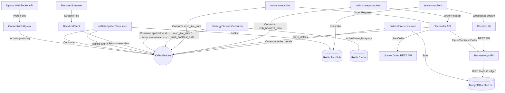

# MoneyMaker System Architecture & Flows

Welcome to the MoneyMaker system flow documentation. This directory contains detailed architectural maps, execution sequences, and specifications for all components in the repository. It serves as a single source of truth for understanding how tick data flows through the system, how strategies evaluate signals, and how orders are routed and verified.

## Architectural Overview

MoneyMaker is a collection of event-driven containerized microservices built on Node.js. It supports both **Live Trading** (integrating with the Upstox API) and **Chronological Backtesting** (streaming historical stock data).

## Documentation Files

Please refer to the specific files below for detailed deep dives:

1. **[Backtest Flow](backtest_flow.md)**: Details the chronological flow of historical data starting from the `backtest-streamer`, through the `backtest-client`, strategy chooser, the MSB backtest consumer, up to the mock trade execution in `BackTestApp`.
2. **[Live Trading Flow](live_trading_flow.md)**: Details how the real-time Upstox WebSocket feed is ingested by `ConnectWS-Upstox`, parsed using Protobuf, split by symbol, cached in Redis, and evaluated by the live MSB strategy.
3. **[Kafka Topics & Services](kafka_and_services.md)**: Documenting all Kafka brokers, topics, consumers, partitioners, and the shape of JSON messages.
4. **[Microservices & REST APIs](microservices_and_api.md)**: Describes all Express endpoints, controllers, and utility classes, including database collections and authentication.
5. **[Docker & Infrastructure](docker_and_stack.md)**: Summarizes the container definitions in `docker-compose.yml`, overlay networks, configurations, and volumes.
6. **[Identified Issues Audit](../issues.md)**: A detailed log of bugs, race conditions, naming inconsistencies, and architectural concerns discovered during this code review.
7. **[Test Case Plans](../test_case_plans/README.md)**: Master index of 678+ test cases across 26 plans covering every docker-compose service, BackTestApp/UI flows, and regression tests for all open issues.
