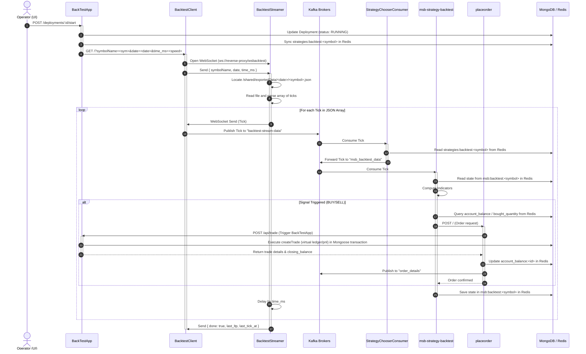

# Chronological Backtest Flow

This document details the step-by-step execution path when running a strategy in **BACKTEST** mode. It covers the flow from triggering the run in the user interface, reading historical JSON data, routing ticks through Kafka, evaluating signals, and executing mock trades.

## Sequence Diagram

---

## Detailed Execution Steps

### 1. Initiation and Deployment Activation
* **UI Action**: The operator navigates to the dashboard or strategies list in the UI and clicks **Start** on a deployment configured with `strategy_mode: "BACKTEST"`.
* **REST API Call**: The UI makes a POST request to `/backtestapp/deployments/:id/start`.
* **State Change**:
  * The `transitionDeployment` function in `BackTestApp`'s `deployment.js` service is invoked.
  * It sets `current_status: "RUNNING"` and `start_time: new Date()`.
  * It calls `syncAllDeploymentsToRedis()`, which updates active strategies inside Redis:
    * Key: `strategies:backtest:${symbol}`
    * Value: A JSON array of active strategies containing properties: `name`, `isTest` (always `true` for backtest), `account_id`, `instrument_token`, `symbol`, `strategy_id`, `deployment_id`, and `is_internal_broker`.

### 2. Client Activation
* **Triggers Job**: The `deployment.js` service executes `triggerBacktestIfNeeded(deployment)`.
* **HTTP Dispatch**: It triggers the `BacktestClient` by making a GET request:
  `http://backtest-client/?symbolName=${symbol}&date=${date}&time_ms=${speed}`
* **Express Handler**: In `BacktestClient/clientServer.js`, the `/` GET handler sanitizes input parameters and calculates the partition key:
  `partitionKey = backtest-${symbolName}-${date}-${speed}`

### 3. Tick Streaming
* **WebSocket Connection**: `BacktestClient` initiates a WebSocket client to `WS_URL` (points to Nginx reverse proxy endpoint `/wsbacktest`, which routes to `backtest-streamer:8085`).
* **Retrieval Request**: On connection open, the client sends the payload `{ symbolName, date, time_ms }`.
* **File Reading**:
  * The `backtest-streamer/streamer.js` catches the connection and parses the request.
  * It sanitizes the symbol and locates the file: `/shared/exportedData/<date>/<sanitizedSymbol>.json`.
  * `sourceRetriever.js` reads the file from disk asynchronously and parses the JSON string to an array.
* **Throttled Push**:
  * The streamer loops through each element in the array.
  * If `time_ms` is > 0, it pushes the tick to the WebSocket and delays the next iteration using a promise-wrapped `setTimeout`.
  * If `time_ms` is 0, it streams them sequentially with no artificial delay.
  * At the end of the array, the streamer sends a `{ done: true, last_ltp, last_tick_at }` signal down the socket, carrying the LTP and exchange time of the final tick that had a usable price. This is the authoritative end-of-data mark that any still-open position is force-closed at.

### 4. Ingestion to Kafka
* **Kafka Publish**: As the `BacktestClient` receives ticks over the WebSocket, its `ws.on('message')` listener publishes the stringified tick directly to the Kafka broker:
  * Topic: `backtest-stream-data`
  * Message Key: `partitionKey` (determines partition mapping, ensuring all ticks for a specific backtest run land in the same partition order).

### 5. Strategy Selection and Forwarding
* **Consumer**: `StrategyChooserConsumer.js` consumes from `backtest-stream-data`.
* **Symbol Lookup**: The consumer parses the message key to identify the `symbol` and inspects the message topic to determine if it is a backtest run (`topic === BACKTEST_TOPIC`).
* **Active Strategies**: It retrieves active strategies from Redis key `strategies:backtest:${symbol}` via `getStrategiesForSymbol()`.
* **Forwarding**: For each active strategy (e.g. `MSB`):
  * Sets `isTestMode = true` and forces `data.strategy_details.isTest = true`.
  * Publishes the tick payload (augmented with `strategy_details`) to Kafka topic `${strategyName}_backtest_data` (e.g., `msb_backtest_data`).

### 6. Strategy Evaluation (MSB Bot)
* **MSB Consumer**: The `msb-strategy-backtest` container runs `server.js` with `SERVICE_MODE: backtest`. It subscribes to `msb_backtest_data`.
* **State Retrieval**: It fetches the previous state for the symbol from Redis:
  * Key: `msb:backtest:${symbol}`
  * Default: `{ isUp: null, prevHigh: { high, low }, prevLow: { high, low } }`
* **Indicator Logic**: It compares the high, low, and LTP of the tick against the previous highs/lows:
  * **Uptrend Check**: If currently in uptrend (`isUp === true`), it checks if `prevHigh.low > current.low`. If yes, the trend broke downward: sets `isUp = false`, starts a downtrend, and triggers a **SELL** order. Otherwise, it updates `prevHigh.high` and `prevHigh.low` if higher highs are made.
  * **Downtrend Check**: If currently in downtrend (`isUp === false`), it checks if `prevLow.high < current.high`. If yes, the trend broke upward: sets `isUp = true`, starts an uptrend, and triggers a **BUY** order. Otherwise, it updates `prevLow.low` and `prevLow.high` if lower lows are made.
* **Payload Assembly**:
  * Calls `computeOrderPayload` inside `MSB.js`.
  * If `use_full_amount` is enabled:
    * For a **BUY** order, it reads the virtual account balance from Redis key `account_balance:${account_id}` and divides it by the LTP (adjusted for `lot_size` if configured) to calculate quantity.
    * For a **SELL** order, it reads the bought quantity from Redis key `bought_quantity:${symbol}` and sells that exact amount.
* **Trigger Order**: Sends a POST request to `PLACEORDER_API` (`http://placeorder`).
* **State Save**: Updates the state details in `msb:backtest:${symbol}` in Redis.

### 7. Order Execution & Settlement (Simulation)
* **API Handler**: `placeorder`'s server receives the request.
* **Router Check**:
  * Since `strategy_details.strategy_mode` is `BACKTEST` (which is not `LIVE`), it skips placing the order with the external broker (Upstox).
  * It directly hits `triggerBackTestApp(body)` which calls the legacy endpoint on the `backtest-app` service:
    `POST http://reverse-proxy/backtestapp/api/trade`
* **Database Settlement (Mongoose Transaction)**:
  * `BackTestApp`'s `createTrade` runs within a Mongoose transaction session.
  * It locates the target virtual `Account` in MongoDB (creating one with a 40,000 virtual balance if it doesn't exist).
  * Calculates broker commission based on whether the account is configured for flat rates or percentages.
  * Deducts the trade value + commission from the virtual balance for **BUY** orders (checking for insufficient balance).
  * Pulls all previous trades for this deployment in chronological order to calculate the current average entry price and calculates the realized P&L for closing positions.
  * Creates a new `Trade` document in MongoDB.
  * Creates a `Ledger` document in MongoDB (tracks balance progression).
  * Updates the account balance in MongoDB.
* **Redis Update**: `placeorder` receives the response containing `closing_balance` and updates the Redis key `account_balance:${account_id}`.
* **Order History Topic**: `placeorder` calls `storeOrderDetails` to publish the order parameters to the `order_details` Kafka topic, which is consumed by `order-storer-consumer` and saved in MongoDB under the `order_details` database for reference.
