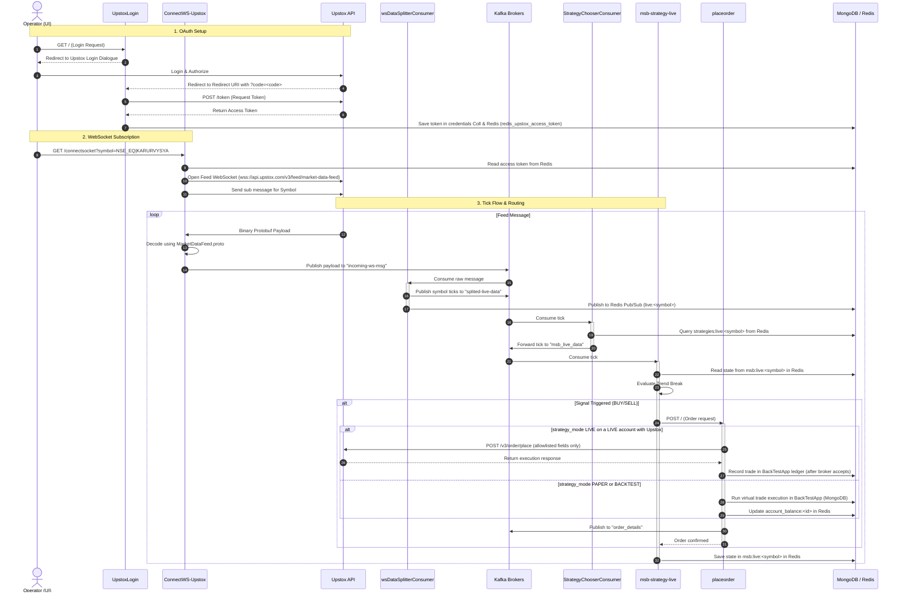

# Live Trading & Real-time Flow

This document details the step-by-step execution path for real-time market data ingestion and order execution in **LIVE** and **PAPER** trading modes. It covers oauth authentication, WebSocket feeds, splitting tick feeds, and routing orders to the external broker.

## Sequence Diagram

---

## Detailed Execution Steps

### 1. OAuth Authentication and Handshake
* **Trigger**: Accessing the platform for live tracking requires authorization with Upstox.
* **Redirection**: The operator is redirected to Upstox auth page (`https://api.upstox.com/v2/login/dialog?client_id=...`).
* **Callback**: Upon authentication, Upstox redirects to `upstock-login` (`https://localhost/logedin?code=...`).
* **Token Fetch**:
  * `upstock-login` extracts the authorization `code` and posts to Upstox's REST API `/v2/login/authorization/token`.
  * The response contains the access token, client ID, and secret.
* **Storage**:
  * Saves the credentials to the `credentials` collection in MongoDB.
  * Writes the token to the Redis key `redis_upstox_access_token`.

### 2. Live WebSocket Feed Establishment
* **Trigger**: A request is made to `ConnectWS-Upstox` (`GET /connectsocket?symbol=...`).
* **Connection**:
  * The service reads the token from Redis (`redis_upstox_access_token`).
  * Creates a WebSocket client and connects to `wss://api.upstox.com/v3/feed/market-data-feed`.
  * Subscribes to the list of symbols by sending a JSON subscription payload:
    `{ guid: "someguid", method: "sub", data: { mode: "full", instrumentKeys: [symbols] } }`
* **Protobuf Decoding**:
  * Raw binary messages are received on `ws.on("message")`.
  * The service uses `protobufjs` to load `MarketDataFeed.proto` and decodes the buffer into a JSON object:
    `com.upstox.marketdatafeederv3udapi.rpc.proto.FeedResponse`
  * Decoded tick feeds are published to the Kafka topic `incoming-ws-msg`.

### 3. Splitting and Pub/Sub Distribution
* **Ingestion**: `wsDataSplitterConsumer` consumes the parsed batch of ticks from `incoming-ws-msg`.
* **Latency Monitoring**: Measures ingestion speed by calculating the epoch delta (`latency.beforeSplit`).
* **Kafka Routing**: Injects the symbol key (`symbol_name`) and pushes individual ticks to the Kafka topic `splited-live-data`.
* **Redis Pub/Sub**: Stringifies and publishes each tick to a Redis channel named `live:${symbol}` (e.g. `live:NSE_EQ|KARURVYSYA`).
* **UI Streaming**: Connected web browsers subscribing via the `stream-to-client` WebSocket (listening on Nginx location `/clientstreamer`) are automatically fed these messages from the Redis Pub/Sub channel in real-time.

### 4. Strategy Matching (StrategyChooserConsumer)
* **Ingestion**: `StrategyChooserConsumer` consumes from `splited-live-data`.
* **Active Check**: It queries Redis for active live deployments:
  * Key: `strategies:live:${symbol}`
* **Topic Routing**:
  * If a matching deployment is found, it copies the configuration (`strategy_details`).
  * `isTest` is true only for BACKTEST deployments, so LIVE and PAPER deployments both receive live ticks.
  * Routes the message to the Kafka topic `${strategyName}_live_data` (e.g., `msb_live_data`).

### 5. Strategy Calculation (msb-strategy-live)
* **Ingestion**: The `msb-strategy-live` consumer reads ticks from `msb_live_data`.
* **Trend Tracker**: Evaluates price movements against thresholds from Redis state (`msb:live:${symbol}`).
* **Signal Triggers**:
  * **Uptrend Break (SELL)**: High-to-low comparison breaks the current trend.
  * **Downtrend Break (BUY)**: Low-to-high comparison breaks the current trend.
* **Order Request**: Assembles an order payload (getting balances/quantities from Redis) and triggers order placement by POSTing to the `placeorder` API.

### 6. Order Routing & Verification
* **Ingestion**: The `placeorder` service receives the trade request. It rejects an order without `client_order_id` (400).
* **Routing Decision** (`resolveExecutionMode`; `strategy_mode` is the only input, `isTest` is ignored):
  * **Live Trading** (`strategy_mode === "LIVE"`, `account_type === "LIVE"`, `is_internal_broker === false`, `external_broker_id === "upstox"`):
    * Gets the user's Upstox access token from Redis.
    * Builds the Upstox V3 body from an allowlist (see [upstox_place_order_v3.md](./upstox_place_order_v3.md)) and calls `POST /v3/order/place`.
    * Records the trade in the BackTestApp ledger only after Upstox accepts, then updates the Redis balance.
    * Publishes execution details to `order_details` Kafka topic.
    * A LIVE order on an account that fails any of these checks is refused (409), never booked internally.
  * **Paper Trading** (`strategy_mode === "PAPER"`, never reaches a broker):
    * Bypasses Upstox.
    * Invokes the internal `BackTestApp` REST API at `POST /api/trade` to settle virtual balances.
    * Receives the new closing balance and updates the Redis key `account_balance:${account_id}`.
    * Publishes execution details to `order_details` Kafka topic.
