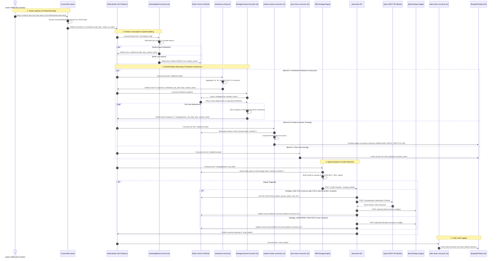
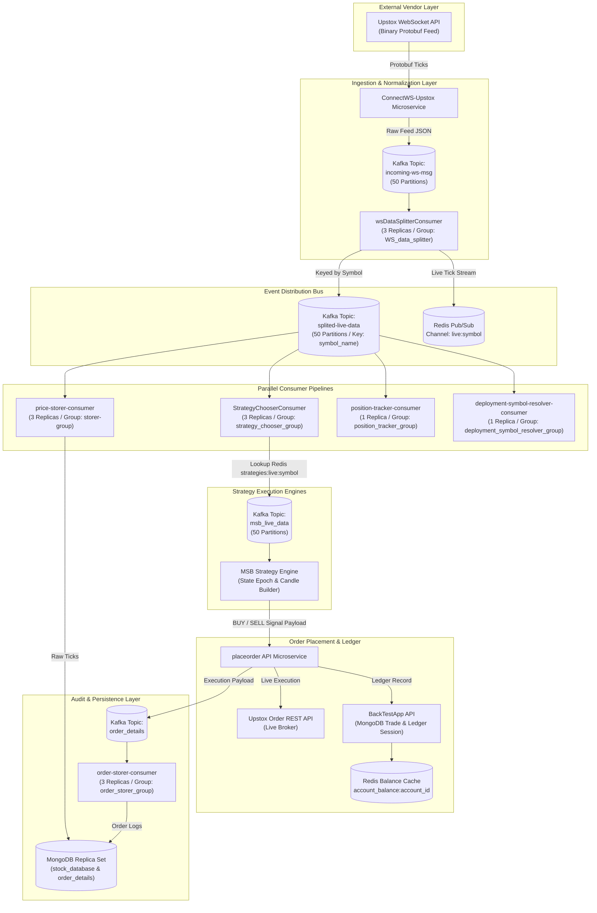

# Vendor to Order Execution: End-to-End Real-Time Data Flow

This document details the complete real-time data pipeline in **MoneyMaker**, tracing market data from the external broker vendor (Upstox WebSocket API) down to order execution. It covers multi-replica scaling, Kafka partition key routing, data spike buffering, write throttling, and all multi-entity matrix combinations (multiple symbols, deployments, strategies, and accounts).

---

## 1. Executive Summary & Microservices Topology

MoneyMaker utilizes a high-throughput, event-driven microservices architecture built on **Node.js**, **Apache Kafka** (3-broker cluster with 50 partitions per topic), **Redis** (caching, state management, Pub/Sub), and **MongoDB** (ACID multi-document replica set).

| Microservice Component | Docker Service Name | Replicas | Role / Responsibility |
| :--- | :--- | :--- | :--- |
| **Upstox Login** | `upstock-login` | 1 | Handles OAuth authorization, exchanges code for access tokens, saves to MongoDB & Redis. |
| **Upstox WebSocket Gateway** | `connect-upstox-web-socket` | 1 | Maintains persistent binary Protobuf WebSocket connection to Upstox, publishes raw batches to Kafka. |
| **WebSocket Data Splitter** | `wsdatasplitter-consumer` | 3 | Consumes raw batches, splits them into individual symbol ticks, publishes key-partitioned messages to Kafka and Redis Pub/Sub. |
| **Timeframe Constructor** | `timeframe-constructor` | 1–3 | Consumes raw ticks, centrally constructs candles (1m, 3m, 5m, 15m), and publishes synchronized multi-timeframe snapshots to `timeframe_live_data`. |
| **Price Storer** | `price-storer-consumer` | 3 | Consumes split tick stream and persists raw ticks into MongoDB database `stock_database`. |
| **Position Tracker** | `position-tracker-consumer` | 1 | Monitors live mark-to-market (MTM) unrealized PnL and price excursions (`max_up`, `max_down`). |
| **Deployment Symbol Resolver** | `deployment-symbol-resolver-consumer` | 1 | Dynamic option chain strike tracking; triggers symbol resolution when index LTP moves. |
| **Strategy Chooser** | `strategy-chooser-consumer` | 3 | Matches tick symbol keys to active user deployments in Redis, slices timeframe snapshots dynamically, and routes ticks to strategy-specific topics. |
| **Strategy Engines** | `msb-strategy-live`, etc. | 3 | Evaluates technical indicators, manages strategy state, enforces real-time tick risk and closed candle breakouts. |
| **Order Placement Gateway** | `placeorder` | 1 | Routes orders to Upstox REST API (Live) or BackTestApp ledger (Paper/Internal), manages multi-account balances. |
| **Order Audit Storer** | `order-storer-consumer` | 3 | Consumes execution payloads and persists completed orders into MongoDB `order_details`. |
| **Client UI Streamer** | `stream-to-client` | 1 | Relays Redis Pub/Sub ticks to frontend web clients via WebSockets. |

---

## 2. End-to-End Sequence Diagram

The following sequence diagram illustrates the tick lifecycle from Upstox to order settlement:



---

## 3. High-Level Data Flow Diagram



---

## 4. Parallel Processing & Multiple Replica Mode

### 4.1 Kafka 50-Partition Architecture
All core Kafka topics (`incoming-ws-msg`, `splited-live-data`, `${strategyName}_live_data`, `order_details`) are initialized with **50 partitions** (`KAFKA_CFG_NUM_PARTITIONS: 50`).

When microservices are deployed in multi-replica mode:
* **`wsdatasplitter-consumer` (3 Replicas)**: Kafka automatically balances the 50 partitions of `incoming-ws-msg` across the 3 container instances (~16-17 partitions per replica).
* **`price-storer-consumer` (3 Replicas)**: Group `storer-group` splits 50 partitions of `splited-live-data` across 3 instances.
* **`strategy-chooser-consumer` (3 Replicas)**: Group `strategy_chooser_group` splits 50 partitions across 3 instances.
* **`order-storer-consumer` (3 Replicas)**: Group `order_storer_group` splits 50 partitions across 3 instances.

```
                  +---------------------------------------------------+
                  |        Kafka Topic: splited-live-data             |
                  |                (50 Partitions)                    |
                  +---------------------------------------------------+
                     /                          |                         \
       Partitions 0-16               Partitions 17-33           Partitions 34-49
              |                                 |                         |
              v                                 v                         v
   +--------------------+            +--------------------+    +--------------------+
   | strategy-chooser   |            | strategy-chooser   |    | strategy-chooser   |
   | Replica 1          |            | Replica 2          |    | Replica 3          |
   +--------------------+            +--------------------+    +--------------------+
```

### 4.2 Kafka Key-Based Hash Partitioning (`key = symbol_name`)
When `wsdatasplitter-consumer` publishes split ticks to `splited-live-data`, it explicitly assigns the **symbol name** as the message key:
```javascript
producer.send({
    topic: "splited-live-data",
    messages: [{ key: "NSE_EQ|KARURVYSYA", value: JSON.stringify(tickValue) }]
});
```

#### Strict In-Order Guarantee
Kafka uses a consistent hashing partitioner (`murmur2(key) % total_partitions`).
* **Guarantee**: Every tick for `NSE_EQ|KARURVYSYA` will **ALWAYS** be routed to the **EXACT SAME PARTITION** (e.g. Partition 12).
* **Concurrency Safety**: Since a single partition can only be consumed by **ONE** replica within a consumer group at any time, all market ticks for a specific symbol are processed sequentially in strict chronological order. This eliminates race conditions across replicas!

### 4.3 Stateless vs. Stateful Replica Scaling
* **Stateless Microservices** (`wsdatasplitter-consumer`, `strategy-chooser-consumer`, `price-storer-consumer`, `order-storer-consumer`): Can scale horizontally up to 50 container replicas (1 replica per partition) with zero code changes or shared lock contention.
* **Stateful Microservices** (`position-tracker-consumer`, `deployment-symbol-resolver-consumer`): Run as single instances (1 replica) or maintain partition-isolated in-memory states to track unrealized PnL and strike step movements without cross-replica state conflicts.

---

## 5. Data Spikes & Heavy Load Resilience

During market opening (9:15 AM IST) or high-volatility news events, Upstox transmits thousands of tick messages per second. The system uses multiple buffering and throttling layers to maintain stability:

```
[Upstox Feed Spikes] ──> [Kafka Ring-Buffer] ──> [In-Memory Protobuf Parsing] ──> [Throttled MongoDB Writes]
```

### 5.1 Kafka Asynchronous Ring-Buffering
Kafka acts as an enterprise-grade decoupler. Even if downstream consumers suffer transient delays (e.g., MongoDB index builds or API network latency), `ConnectWS-Upstox` continues publishing ticks to Kafka without backpressure clogging the Upstox WebSocket connection.

### 5.2 Binary Protobuf Memory Optimization
Upstox transmits market data as binary Protobuf payloads (`MarketDataFeed.proto`). `ConnectWS-Upstox` decodes Protobuf buffers directly in-memory before emitting JSON messages, minimizing payload size over the wire.

### 5.3 Multi-Tier Write Throttling Mechanisms
To prevent database connection pool exhaustion under heavy tick frequency, specialized consumers enforce configurable write throttles:

1. **Position Excursion Write Throttling (`UNREALISED_WRITE_THROTTLE_MS`)**:
   - `position-tracker-consumer` calculates unrealized MTM on every single tick.
   - Non-critical database updates to MongoDB `positions` collection are throttled (default: `2000ms`).
   - Extreme price moves (new high/low excursion) bypass the throttle and write immediately.
2. **Dynamic Strike Resolution Throttling (`SYMBOL_CONTROL_RESOLVE_THROTTLE_MS`)**:
   - `deployment-symbol-resolver-consumer` monitors underlying index prices.
   - Resolving API calls to BackTestApp (`POST /deployments/:id/resolve-symbol`) are throttled (default: `5000ms`) per deployment to prevent hammering the REST API during fast index ticks.

### 5.4 Microsecond Redis In-Memory State & Epoch Checks
* Active deployment lookup (`strategies:live:${symbol}`) is served directly from Redis JSON memory (`< 1ms` response).
* **State Epoch Protection (`assertFreshStateEpoch`)**: Every strategy tick evaluation verifies that `message.state_epoch === strategy_details.state_epoch`. If a user updates deployment parameters while ticks are queued in Kafka, stale ticks are discarded immediately before state modification.

---

## 6. Multi-Entity Matrix Cases

The table below outlines how the data flow adapts across every combination of symbols, deployments, strategies, and accounts:

| Scenario Case | Condition | Flow Behavior & System Execution |
| :--- | :--- | :--- |
| **Case 1: Multiple Symbols** | WS streams ticks for 50+ symbols simultaneously. | `ConnectWS-Upstox` receives a single batched JSON feed containing 50 symbols. `wsDatasplitterConsumer` splits the batch and publishes 50 distinct messages to Kafka `splited-live-data`, keyed by each symbol name (`key = symbol`). Each symbol routes to its assigned partition. |
| **Case 2: Multiple Deployments on Same Symbol** | 5 different users deploy strategies on `NSE_EQ|RELIANCE`. | When a tick for `NSE_EQ|RELIANCE` arrives at `StrategyChooserConsumer`, it fetches `strategies:live:NSE_EQ|RELIANCE` from Redis, returning 5 deployment configurations. The chooser **clones the tick 5 times**, attaches each deployment's metadata (`deployment_id`, `user_id`, `account_id`, `parameters`, `state_epoch`), and publishes 5 messages to the strategy Kafka topic. |
| **Case 3: Multiple Strategies on Same Symbol** | User A runs `MSB` strategy and User B runs `LiquiditySweep` on `NIFTY`. | `StrategyChooserConsumer` inspects the strategy name in each deployment payload. It routes User A's tick to `msb_live_data` and User B's tick to `liquidity_sweep_live_data`. Independent strategy engine instances consume their respective topics in parallel without interfering with each other's candle builders. |
| **Case 4: Multiple Accounts & Users** | User 1 (Account ACC-01) and User 2 (Account ACC-02) trigger order signals. | When `MSB` strategy emits an order signal, the payload includes `strategy_details.user_id` and `strategy_details.account_id`. The `placeorder` service retrieves User 1's OAuth token (`upstox_access_token:user_1`) for Upstox API dispatch, while User 2's token is fetched for User 2. After execution, `placeorder` updates Redis keys `account_balance:ACC-01` and `account_balance:ACC-02` independently. |
| **Case 5: Hybrid LIVE & PAPER Trading** | User has 1 LIVE deployment (on a LIVE Upstox account) and 1 PAPER deployment (on a PAPER account) on `NSE_EQ|SBIN`. | A deployment's mode must match its account type (LIVE→LIVE, PAPER→PAPER, BACKTEST→SIMULATION), enforced at creation. `placeorder` routes by `strategy_mode` only: the LIVE order goes to the Upstox V3 REST API and the PAPER order is booked in the `BackTestApp` ledger and never reaches a broker. Both executions emit payloads to `order_details` for MongoDB auditing. |

---

## 7. Verification & Audit Trail

Every order execution produces a full audit trail across system stores:

1. **Raw Market Ticks**: Stored in MongoDB database `stock_database`, collection `<symbol_name>`.
2. **Strategy Calculations**: State persisted in Redis key `msb:live:<symbol_name>` and logged to stdout via `logUtils.js`.
3. **Ledger & Balances**: Transaction recorded in MongoDB `trades` and `ledgers` collections via ACID session transactions in `BackTestApp`, cached in Redis `account_balance:<account_id>`.
4. **Order Execution Audit**: Complete request/response payload stored in MongoDB `order_details` collection by `order-storer-consumer`.
